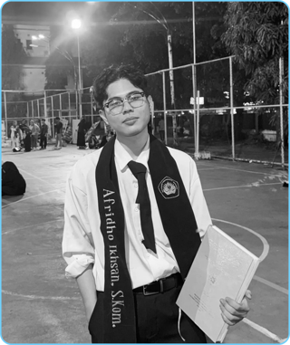

<div align="center">
  
  <br/><br/>
  
  <br/><br/>
  <a href="https://anthrofax.my.id">
    
  </a>
</div>

<p align="center">
  <a href="https://anthrofax.my.id" target="_blank">
    
  </a>
  <a href="https://www.linkedin.com/in/afridhoikhsan/" target="_blank">
    
  </a>
  <a href="mailto:afridhoikhsan@gmail.com" target="_blank">
    
  </a>
  
</p>

---

### ⚡ `about_me.ts`

```typescript
interface Engineer {
  name: string;
  degree: string;
  role: string;
  passions: string[];
  currentFocus: string[];
  motto: string;
}

const afridho: Engineer = {
  name: "Afridho Ikhsan",
  degree: "S.Kom. (Bachelor of Computer Science)",
  role: "Web & Mobile Engineer / Full-Stack Developer",
  passions: [
    "Building reactive cross-platform mobile apps with Flutter",
    "High-throughput backend microservices with Go & Node.js",
    "Interactive, snappy frontend architectures with Next.js & Vue",
    "Edge deployments & modern cloud infra with Cloudflare"
  ],
  currentFocus: [
    "National digital cooperative ecosystems (Kopdes & Kemenkop)",
    "Fierto Eyewear digital brand & e-commerce engine",
    "High-performance PWA & autonomous agent integrations"
  ],
  motto: "Functionality + Aesthetics = Ultimate Experience"
};
```

---

### 🛠️ Tech Stack & Ecosystem

<div align="center">

#### 🌐 Frontend & Mobile Development
<p align="center">
  
</p>

#### ⚙️ Backend, Cloud & DevOps
<p align="center">
  
</p>

#### 🗄️ Databases & Developer Tools
<p align="center">
  
</p>

</div>

---

### 🚀 Highlighted Products & Works

| Project | Description | Tech Stack | Status |
|:---|:---|:---|:---:|
| **[Toserbanet](https://github.com/afridho-ikhsan/toserbanet)** | Full-Stack digital commerce & operations platform | Next.js, Node.js, Tailwind | 🟢 In Production |
| **[Fierto Eyewear](https://github.com/afridho-ikhsan/fierto-eyewear)** | Eyewear brand storefront & lightweight high-speed REST API | Vue 3, Go stdlib, Cloudflare | 🟢 Active |
| **[Kopdes Merah Putih & Kemenkop](https://github.com/afridho-ikhsan)** | Enterprise ecosystem for national cooperative digitalization & SPPI | Flutter, Laravel, Cloudflare | 🔨 Active Dev |
| **[Hermes Mobile](https://github.com/afridho-ikhsan/hermes-mobile)** | Autonomous AI agent mobile & PWA companion interface | Flutter, PWA, Cloudflare Pages | 🟢 Shipped |
| **[Selena AI](https://github.com/afridho-ikhsan/selena-backend-service)** | Scalable AI backend services & cloud infrastructure | Node.js, GCP, Cloud Run | 🏁 Completed |

---

### 📊 GitHub Activity & Metrics

<div align="center">
  <table border="0">
    <tr>
      <td valign="top" width="50%">
        
      </td>
      <td valign="top" width="50%">
        
      </td>
    </tr>
  </table>
  <br/>
  
</div>

<br/>

<div align="center">
  
</div>
